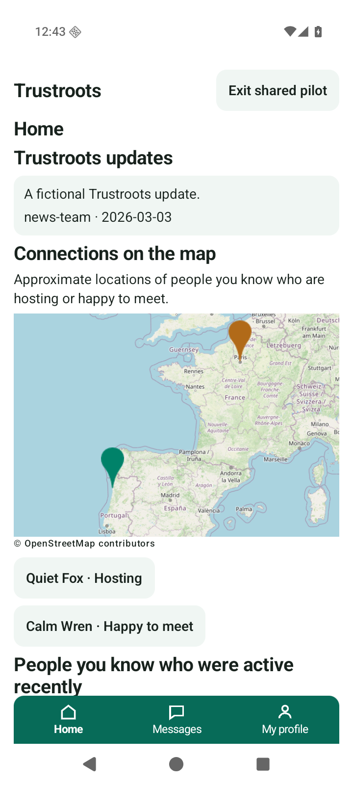
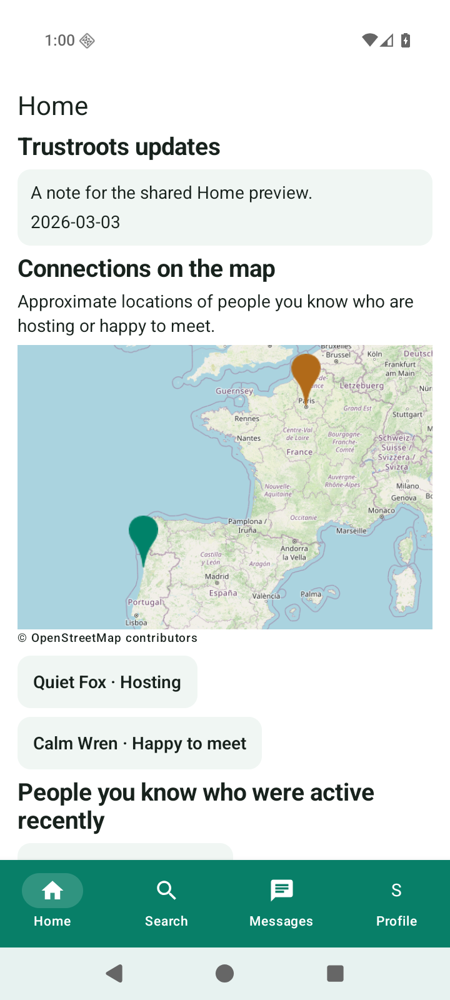

# Shared Kotlin and Compose UI assessment

Status: source assessment prepared 22 October and updated 26 October 2026.
Related: [#3232](https://github.com/Trustroots/trustroots/issues/3232). This
assessment records the shared build foundation and the later debug member
journey pilot. The working SwiftUI iOS app remains
the comparison baseline.

## Recommendation and agreed direction

Proceed towards shared Kotlin application logic and Compose UI in reversible
increments within the existing Android and iOS applications. Choose the stronger
existing implementation feature by feature rather than treating either app as
the complete product specification. Use a shared design with platform-specific
behaviour where it improves the experience.

The first implementation milestone is **sign-in → profile → conversation →
reply** on both platforms, using real APIs, existing secure saved sessions and
basic error handling. Include inbox navigation so conversations remain reachable
from the existing Messages destination. Compose owns navigation within this
journey; SwiftUI hosts its controller and retains destinations not yet migrated.
Make migrated iOS destinations the default after acceptance checks, without a
developer toggle. The limited current iOS audience permits a fast transition
while retaining verification of credentials and message handling.
Preserve Android behaviour and existing offline capabilities during extraction.

This is a preferred direction, not evidence that migration savings have already
been achieved. Stop or revise the approach if the first journey cannot preserve
core behaviour at reasonable integration cost. Do not retire SwiftUI merely
because a Compose screen compiles.

## Alternatives

🟢 Advantage · 🟡 Tradeoff or unverified benefit · 🔴 Disadvantage

| Criterion                          | Separate native apps      | Shared logic, native UI           | Shared logic and Compose UI                 |
| ---------------------------------- | ------------------------- | --------------------------------- | ------------------------------------------- |
| Preserve current screens           | 🟢 Keep both              | 🟢 Keep both                      | 🟡 Replace incrementally                    |
| Avoid duplicated application logic | 🔴 Implement twice        | 🟢 Share                          | 🟢 Share                                    |
| Avoid duplicated screen work       | 🔴 Implement twice        | 🔴 Implement twice                | 🟢 Share suitable screens                   |
| Initial integration effort         | 🟢 No migration           | 🟡 Extract logic and bridge Swift | 🔴 Extract logic, adapt UI and bridge Swift |
| Native iOS control                 | 🟢 SwiftUI/UIKit          | 🟢 SwiftUI/UIKit                  | 🟡 Verify shared UI; retain native adapters |
| Build complexity                   | 🟡 Two established builds | 🟡 Add Kotlin/Native              | 🟡 Add Kotlin/Native and Compose            |
| Ongoing maintenance savings        | 🟡 Continued duplication  | 🟡 Depends on logic reuse         | 🟡 Greater potential, unmeasured            |

The recommendation reflects the agreed goal of sharing both behaviour and UI.
There is no weighted score, measured sharing percentage or assumed break-even
date. Native-only development remains the rollback option; sharing logic alone
is the intermediate option if shared UI proves unsuitable.

## Source evidence and reuse boundaries

Paths below are relative to this directory. Existing test names establish
coverage intent; this assessment has not rerun mobile tests. OpenSpec task
checkboxes are not treated as evidence of feature absence or completion.

| Area                         | Existing evidence                                                                                                                                                                                                                                                                                                                               | Sharing decision and remaining work                                                                                                                                                                                                                  |
| ---------------------------- | ----------------------------------------------------------------------------------------------------------------------------------------------------------------------------------------------------------------------------------------------------------------------------------------------------------------------------------------------- | ---------------------------------------------------------------------------------------------------------------------------------------------------------------------------------------------------------------------------------------------------- |
| Models and validation        | Android [API models](android/app/src/main/java/org/trustroots/android/api/MobileApiClient.kt), [coordinate validation](android/app/src/main/java/org/trustroots/android/api/GeoCoordinates.kt); iOS [API and models](ios/TrustrootsApp/TrustrootsAPI.swift)                                                                                     | Kotlin data classes and pure validation are extraction candidates. Decouple models from `org.json`, JVM dates and platform imports. Compare nullable fields and profile statistics against Swift decoding before selecting the common contract.      |
| Networking                   | Android uses `HttpURLConnection`, `java.net`, `org.json` and `Dispatchers.IO`; iOS uses Foundation and native decoding                                                                                                                                                                                                                          | Neither client can be copied wholesale into common code. Plan a common repository and JSON contracts with Ktor platform engines. Preserve origin validation, request headers, error distinctions and cancellation; add no new server routes.         |
| Session lifecycle            | Android [session view model](android/app/src/main/java/org/trustroots/android/ui/session/AppSessionViewModel.kt) and [Keystore store](android/app/src/main/java/org/trustroots/android/api/SecureMobileSessionStore.kt); iOS [session store](ios/TrustrootsApp/MemberSessionStore.swift) and Keychain credential store in `TrustrootsAPI.swift` | Reuse native persistence through injected interfaces. Native and shared screens must observe one session, not two independent cookie stores. Retain stale-response protection and account/cache clearing on logout.                                  |
| Compose screens              | Android [profile screen](android/app/src/main/java/org/trustroots/android/ui/profile/MemberProfileScreen.kt) and [feature packages](android/app/src/main/java/org/trustroots/android/ui)                                                                                                                                                        | Layouts and state presentation are candidates, not directly portable files: profile imports Android activity/context, HTML and back handling. Extract platform actions and rendering first. Compare features with SwiftUI before moving each screen. |
| Navigation                   | Android [root shell](android/app/src/main/java/org/trustroots/android/ui/TrustrootsApp.kt); iOS [root view](ios/TrustrootsApp/TrustrootsRootView.swift)                                                                                                                                                                                         | Keep native application entry points. Compose owns the shared journey and reports exits to native hosts; prevent duplicate navigation bars and back stacks. Preserve links into unmigrated destinations.                                             |
| Maps and location            | Android osmdroid in the [build dependencies](android/app/build.gradle.kts); iOS [MapKit offer map](ios/TrustrootsApp/OfferMapView.swift) and [location manager](ios/TrustrootsApp/CurrentLocationManager.swift)                                                                                                                                 | Share filters, coordinates and request state later. Retain platform map views, attribution and location permissions. A common map implementation is not required for shared surrounding UI.                                                          |
| Offline data and drafts      | Android [encrypted response cache](android/app/src/main/java/org/trustroots/android/api/SecureResponseCache.kt) and [draft store](android/app/src/main/java/org/trustroots/android/api/MessageDraftStore.kt); iOS [response cache](ios/TrustrootsApp/OfflineResponseCache.swift)                                                                | Existing platform caches are valuable adapters. Defer a new common offline design; do not bypass current caches or silently discard drafts when redirecting existing destinations.                                                                   |
| Notifications and updates    | Android [message alerts](android/app/src/main/java/org/trustroots/android/notifications/MessageAlerts.kt) and [APK updates](android/app/src/main/java/org/trustroots/android/updates/ApkUpdateAlerts.kt)                                                                                                                                        | UnifiedPush and APK updates remain Android-specific. iOS notification/background delivery needs its own design and permission/release work; shared Compose UI does not supply it. Preserve Android notification routing into conversations.          |
| Embedded browser             | Android [browser](android/app/src/main/java/org/trustroots/android/browser/TrustrootsBrowser.kt); iOS [WKWebView host](ios/TrustrootsApp/TrustrootsBrowserView.swift)                                                                                                                                                                           | Keep native browser adapters and allowlists. Native API credentials must not enter a shared browser cookie store. Preserve recovery, confirmation, external-link and browser-back behaviour.                                                         |
| Nostr                        | Android [relay client](android/app/src/main/java/org/trustroots/android/api/NostrootsNotes.kt); iOS [identity](ios/TrustrootsApp/NostrIdentity.swift) and [NIP-07 bridge](ios/TrustrootsApp/NIP07Bridge.swift)                                                                                                                                  | Android OkHttp and JSON are platform dependencies; iOS uses a pinned native SDK. Share data and validation only after separate review; preserve native key storage and origin permissions.                                                           |
| Accessibility and appearance | iOS [design guardrail](ios/DESIGN.md), existing SwiftUI accessibility labels, Android Compose semantics                                                                                                                                                                                                                                         | Preserve Trustroots colours and system appearance. Validate VoiceOver/TalkBack, large text, focus, safe areas, keyboard dismissal, multiline reply and back gestures on devices. No equivalence or performance claim is made from source inspection. |

The existing iOS [contract tests](ios/TrustrootsTests/TrustrootsTests.swift)
exercise route paths, stored cookies, isolated URL-session cookie storage,
decoding and offline cache scope. Android has both [unit tests](android/app/src/test)
and [device journeys](android/app/src/androidTest), including sessions, caches,
browser behaviour and notifications. Port useful assertions into common tests;
keep native tests for platform boundaries rather than replacing them with mocks.

## Toolchain, builds and releases

The Android application uses Android Gradle Plugin **9.2.1** and Gradle
**9.4.1**, targets SDK 37 with minimum SDK 26, and uses Java 17 source
compatibility. The shared module pins Kotlin **2.4.21** and Compose
Multiplatform **1.12.2**. JetBrains' [KMP compatibility table](https://kotlinlang.org/docs/multiplatform/multiplatform-compatibility-guide.html)
lists Kotlin 2.4.20–2.4.21 with Gradle through 9.7.0, AGP through 9.3.1 and
Xcode 26.4; the retained Gradle and AGP pins fit those ranges. Compose
Multiplatform releases separately from Kotlin; its [compatibility table](https://kotlinlang.org/docs/multiplatform/compose-compatibility-and-versioning.html)
lists 1.12.2 as compatible with the latest Kotlin release. The Kotlin Compose
compiler plugin matches Kotlin 2.4.21.

The checked-in iOS project targets iOS 17 and Swift 5 language mode. Local
Xcode reports **27.1**, outside the documented KMP compatibility entry. The
iOS CI job selects **Xcode 26.4.1** for the shared framework build. On the local
host, both Kotlin/Native framework linking and an Xcode simulator-SDK app build
completed, but CoreSimulator is older than Xcode 27.1 and simulator device
support is unavailable. These local results do not establish a supported
toolchain combination or a simulator launch; the pinned CI job remains the
compatibility gate.

The build foundation adds `apps/shared`, a minimal Compose entry point, and a
SwiftUI controller wrapper. At the foundation stage, both apps compiled the wrapper without presenting it. The Android debug APK, iOS simulator framework and existing SwiftUI
app build succeeded locally. The foundation stage verified builds. Runtime acceptance for the member journey,
credential handling, API behaviour, accessibility and performance remains a
separate gate for issue #3232.

The [documented SwiftUI integration](https://kotlinlang.org/docs/multiplatform/compose-swiftui-integration.html)
embeds a `ComposeUIViewController` using `UIViewControllerRepresentable`.
Use that boundary inside the existing iOS app rather than creating another
bundle identifier. Audit the selected release's required Info.plist settings
and [platform behaviours](https://kotlinlang.org/docs/multiplatform/compose-platform-specifics.html).

Keep the existing Android Gradle root, include a shared KMP library under
`apps/shared` from that root. Build Android and arm64 iOS
device/simulator targets; embed its framework in the existing Xcode project and
update the project generator as well. Use the supported Android KMP library
plugin rather than combining an Android application and KMP plugin in one module.
Keep Swift-facing entry points small: controller creation, session operations
and host navigation callbacks. Avoid exposing every Kotlin model to Swift.

Android APK and iOS simulator workflows now react to shared-source changes.
The iOS CI job uses JDK 17 and builds the Gradle framework before Xcode tests.
App Store builds will also need the framework built in Xcode Cloud, in
addition to existing signing. Preserve current application identifiers, signing
and distribution; do not trigger an App Store upload during evaluation. Existing
[iOS delivery instructions](ios/README.md#app-store-connect-delivery) describe an
Xcode Cloud branch condition managed outside this repository, which must be
verified before a release. Binary size, startup, clean/incremental build time
and framework integration cost remain measurements for the implementation phase.

## Incremental implementation plan

Each stage is a separate small PR with an OpenSpec delta validated before code.
The initial assessment PR changes no application or build configuration.

| Stage                          | Work and acceptance gate                                                                                                                                                                                                                                                                                                                                              | Rollback boundary                                                                                                            |
| ------------------------------ | --------------------------------------------------------------------------------------------------------------------------------------------------------------------------------------------------------------------------------------------------------------------------------------------------------------------------------------------------------------------- | ---------------------------------------------------------------------------------------------------------------------------- |
| 1. Build foundation            | Resolve toolchain compatibility; add `apps/shared`, Android consumption and an embedded iOS Compose controller. Both existing apps must build, with common JVM and iOS simulator tests running in CI; existing app identity and signing remain intact.                                                                                                                | Remove the new module/host integration; no feature or credential migration yet.                                              |
| 2. Logic and session bridge    | Extract member contracts, API repository and feature state. Use common JSON handling and Ktor engines, with adapters to existing secure stores and caches. Test restoration, persistence failure, logout, expired sessions and requests finishing after account changes. Native screens must see the same active session.                                             | Restore native repository calls; preserve credential format and storage keys.                                                |
| 3. First shared journey        | Move sign-in, profile, inbox and conversation/reply into common Compose. Keep navigation inside that journey and callbacks for remaining native destinations. Use real API contracts and deterministic test fixtures. Retain Android offline/draft behaviour via adapters. Wire migrated iOS destinations as defaults only once the journey and platform checks pass. | Restore native destination wiring; retain old screens until acceptance, then remove only redundant migrated implementations. |
| 4. Platform and product review | Compare the journey with existing apps on actual Android/iOS devices: accessibility, keyboard, back navigation, loading/empty/error states and message delivery. Record build/runtime measurements and list feature gaps. Continue only with no blocking session, delivery or usability regression.                                                                   | Fix adapters, narrow shared UI or keep native UI for unsuitable features.                                                    |
| 5. Remaining member features   | Migrate circles, discovery, maps' surrounding UI, profile editing, hosting, account and other member features one at a time. Review the stronger existing behaviour for each. Require native integration and regression checks before switching its destination.                                                                                                      | Keep or restore the previous destination until its own gate passes.                                                          |

The minimal common interfaces are a member repository (sign-in, profile, inbox,
conversation and send), a secure-session adapter (load/save/clear and session
change notification), and host navigation callbacks for unmigrated destinations.
Existing server routes and payloads remain the contracts; no server schema or
public API change is proposed. Capture protected profile actions and session
policies from the stronger implementation rather than reducing a profile to
display-only content when replacing an existing screen.

The first journey must test:

- Fresh sign-in and relaunch with a saved session, without a second sign-in
  when crossing the native/shared boundary; clear feedback if secure saving fails.
- Wrong credentials, expired sessions, unavailable network and empty inbox;
  cancelled or stale requests must not restore a previous account's data.
- Profile → conversation, inbox → conversation, scrolling history and replying;
  preserve existing pagination and prevent duplicate sends from repeated taps.
- A failed reply retains text and permits intentional retry; a successful reply
  appears once. No automatic mutation retries after ambiguous network failure.
- Sign-out clears shared/native session and account-scoped data; credentials
  stay restricted to the configured API origin and out of browser storage/logs.
- Android process recreation, existing offline reading/drafts and notification
  deep links; iOS host entry/exit, safe areas, keyboard and back behaviour.
- At least one end-to-end native journey on each platform using fictional
  accounts against a controlled test server, plus mocked API failure cases.
  Real production credentials and real message content must not enter fixtures.

Retain existing web/server coverage and Android native tests. Shared code needs
its own measured coverage report without weakening the repository's existing
100% client/server thresholds or claiming that web coverage measures mobile UI.

## Effort and ongoing cost

These are planning estimates for one engineer familiar with both apps, in focused
engineering days; they exclude review waiting time and Apple account delays.
They are not measured implementation results or calendar commitments.

| Increment                                                     | Estimate              | Main uncertainty                                                         |
| ------------------------------------------------------------- | --------------------- | ------------------------------------------------------------------------ |
| Supported builds, shared module, SwiftUI host and CI          | 3–6 days              | Kotlin/AGP/Xcode alignment and Xcode Cloud setup                         |
| Common contracts, networking and native session/cache bridges | 4–8 days              | Session races, cache compatibility and Swift coroutine bridging          |
| First shared UI journey                                       | 5–10 days             | Platform-dependent Android screen code and preserving current behaviours |
| Device tests, accessibility review and corrections            | 3–6 days              | Keyboard/focus, lifecycle, navigation and runtime regressions            |
| **First accepted journey, stages 1–4**                        | **15–30 days**        | Re-estimate after stages 1 and 2                                         |
| Remaining member feature migration                            | Additional 20–45 days | Maps, browser/Nostr integration and current feature gaps                 |

During coexistence, maintenance can increase: native implementations, adapters
and shared code all need attention. After migration, budget roughly 1–3 days per
month for routine shared/platform dependency and compatibility work, with major
OS/toolchain releases potentially requiring another 3–10 days each. These are
low-confidence allowances, not historical costs. Two platform builds, native
device QA, signing and release ownership remain necessary even with shared UI.
No cost saving can be claimed until actual feature and maintenance changes are
compared with the existing two-app baseline.

## Evidence limits and completion

The initial assessment used source/test inspection, repository build/release configuration,
the installed Xcode version and the official documentation linked above. No mobile
builds, simulator/device journeys, live API mutations, accessibility checks,
performance measurements or App Store uploads were performed for the assessment.
Documentation validation results belong in the PR's testing record.

A viable fallback requires member feature parity, secure native integrations,
offline behaviour, accessibility, reliable device journeys and a repeatable
signed iOS release.

## First shared member journey pilot

The pilot implements sign-in, a member dashboard, profile viewing, inbox pagination, conversation
navigation and replies in `apps/shared`. Compose owns the journey's screens,
back stack, loading and error states, and reply handling. The Android and iOS
hosts project their existing API models into a small common interface. Each
host still owns its secure session, token refresh and API transport. This
isolates the work of sharing UI from the proposed shared networking migration.

The pilot is available by explicit launch option in debug builds:

- On Android, run `adb shell am start -S -n org.trustroots.android.debug/org.trustroots.android.MainActivity --ez org.trustroots.android.debug.SHARED_MEMBER_PILOT true`.
- On iOS, add `--shared-member-pilot` to the Xcode scheme's launch arguments, or
  run `xcrun simctl launch --terminate-running-process booted org.trustroots.trustrootsApp --shared-member-pilot`.
- Choose **Exit shared pilot** on the pilot's first screen to return to the
  existing app with the same session. Android also supports system Back.

Use an existing test account or a controlled backend with fictional data to
compare both hosts. Launching the pilot with a saved session opens the
member dashboard. The bottom bar provides **Home**, **Messages** and **My profile**
throughout the signed-in pilot. Home also shows the website's featured Nostr notes and recent
connections, with a native map of approximate locations for connections who
are hosting or happy to meet. The app uses the same eligibility rules and
keeps the core shortcuts available if either feed is unavailable.
From **Messages**, open a conversation directly or view the
other member's profile and then choose **Send a message**.

| Area                  | Pilot                                                                                          | Remaining comparison                                                                                                         |
| --------------------- | ---------------------------------------------------------------------------------------------- | ---------------------------------------------------------------------------------------------------------------------------- |
| Session               | Uses Android Keystore or iOS Keychain via the host                                             | Verify refresh, expiry, interrupted sign-in and repeat launches on both platforms                                            |
| Profiles and messages | Plain-text profiles and messages, paginated inbox, recent conversation, reply and manual retry | Compare complete profiles, safety actions, unread state, history limits, attachments or rich content, and notification entry |
| Offline data          | Uses host API caches, Android's existing draft store, and an in-memory iOS draft               | Check saved-data indicators, cache parity and process recreation                                                             |
| Device behaviour      | Native host with shared controls and shared navigation                                         | Check VoiceOver, TalkBack, dynamic text, keyboard, screen insets and Back on supported devices                               |
| Distribution          | Uses the existing Android and iOS debug apps                                                   | Verify pinned Xcode CI, APK/app size and startup, followed by repeatable signing and release                                 |

The focused Android journey passed on a Pixel 8 API 36 emulator. The focused
iOS journey passed on an iPhone 17 Pro iOS 26.5 simulator using ad-hoc signing.
The tests exercised sign-in, native handoff, profile and inbox navigation,
and a rejected reply followed by a successful retry. The iOS run also
verified Keychain session restoration, reply persistence and sign-out across
relaunches. Both journeys used local fixture servers.

The local iOS simulator linker reported that a bundled ICU data object targeted
iOS Simulator 18.5 while the app targets 17.0. The pilot needs runtime checks on
older supported iOS versions before it becomes a default destination.
To test the exact deployment minimum, run the **iOS** GitHub Actions workflow
with **Run on iOS 17.0** enabled. The workflow requests that runtime from Xcode
if necessary, creates an iPhone 15 simulator and runs the same tests. It fails
if the requested runtime is unavailable so the result cannot be mistaken for
a run on a newer simulator.

Continue the pilot alongside SwiftUI. The next decision should follow
a device comparison with current native behaviour.
Allow the existing estimate of 3–6 engineering days for platform verification
and corrections, then re-estimate the remaining feature work based on those
results. A fallback also requires the native integrations and parity gates
described above.

## Shared request-adapter contract tests

The shared member pilot's callback adapters have portable regression tests in
`shared/src/commonTest`. They cover successful and failed requests, missing data,
repeated native callbacks, cancellation and results supplied just before cancellation.
A callback may arrive after the shared screen leaves composition; it must not
deliver into the cancelled screen or throw when the native host completes twice.

Run the same tests on the Android host JVM without an emulator:

```sh
cd apps/android
./gradlew :shared:testAndroidHostTest
```

On an Apple Silicon Mac with a supported Xcode simulator, run them as Kotlin/Native:

```sh
./gradlew :shared:iosSimulatorArm64Test --device "$SIMULATOR_UDID"
```

The Android APK workflow runs the host suite before building, and the iOS workflow
runs the native suite on its selected iPhone simulator before the native app tests.
This adds common contract coverage without adding a desktop application target.
It does not replace the existing Android and iOS member-journey device tests or
establish Compose UI parity for #3232.

## Shared pilot dashboard

The shared dashboard is a pilot increment towards #3533 within #3232. Native
release home tabs remain unchanged. Optional profile-completion prompts, local
events, localisation and native-default rollout remain follow-up work. The
dashboard Android journeys cover discovery, a failed feed and return navigation;
iOS dashboard build and runtime verification must pass on macOS before rollout.



## Shared Home in the regular app shells

The shared dashboard can now run as the first tab in the existing Android and
SwiftUI member shells. It uses their existing secure sessions, native Search
and Messages, and opens a regular member profile when a connection is chosen.
Circles remains available from Android Profile and iOS Menu.

- Android debug: `adb shell am start -S -n org.trustroots.android.debug/org.trustroots.android.MainActivity --ez org.trustroots.android.debug.SHARED_HOME true`.
- iOS debug: `xcrun simctl launch --terminate-running-process booted org.trustroots.trustrootsApp --shared-home`.

On Android, the fixture journey covers signing in with a saved session, the
Home map and feed, profile restoration across activity recreation, Back,
native tabs and Circles. iOS CI exercises the handoff from the standalone
pilot to the regular shell with the existing Keychain session. The remaining
rollout decision centres on supported-device verification and the performance
comparison described above.


